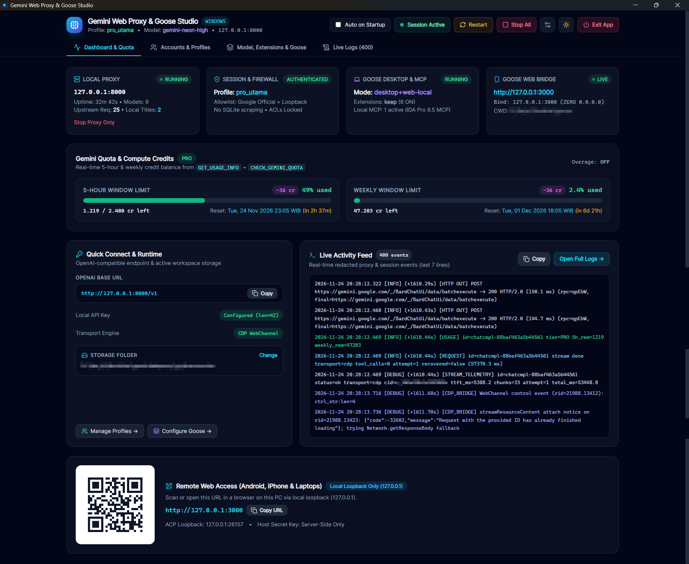

# 🚀 GGSP — Turn Your Google AI Pro Subscription Into a Local OpenAI Agentic API (Zero Extra API Bills!)

[](https://github.com/muhammadalwansyah/ggsp/releases/latest)
[](#why-ggsp)
[](#quick-start-60-seconds)
[](#security--opsec-guarantees)
[](https://github.com/muhammadalwansyah/ggsp/releases/latest)

> **Stop burning $100+/month on per-token LLM API bills when you already pay for Google AI Pro.**
>
> **GGSP (Gemini Goose Studio Proxy)** is a blazing-fast, single-executable **Rust + Tauri v2** desktop studio that turns your existing Gemini Web session into a rock-solid, local **OpenAI-compatible Agentic API (`http://127.0.0.1:8000/v1`)** — with **full tool-calling, native 4K Vision, live quota tracking, and 1-click Goose Desktop + Mobile Web/Tailscale orchestration.**

<p align="center">
  
</p>
<p align="center">
  <em>Live Dashboard: Dual-tier CDP WebChannel transport, real-time 5-hour &amp; weekly quota telemetry, redacted activity feed, and 1-click Goose Desktop + Web QR Bridge.</em>
</p>

---

## ✨ What's New in `v1.1.0`

- **macOS Native Builds (Apple Silicon & Intel):** Added signed-free universal distribution via `.dmg` installers for both `arm64` (`M1/M2/M3/M4`) and `x64` Macs, alongside Windows x64.
- **Cleaner SSE `<tool_call>` Prose Guard:** Inline backtick mentions (like `` `<tool_call>` `` or `` `<tool_call>...</tool_call>` ``) stream cleanly as normal text without buffering tails or emitting false `TOOL_PARSE_FAIL` warnings.
- **Runtime Version Telemetry:** Added `"version": "1.1.0"` to `GET /health` and the desktop header badge, and moved all release binaries exclusively to GitHub Releases so cloning the repository stays instant.

---

## ⚡ Why GGSP?

Most web-to-API proxies break mid-stream, choke on tool calls, leak cookies, or require messy Python environments. **GGSP is compiled to a native Rust + Tauri desktop binary** built specifically for heavy autonomous agent workflows:

- 🧠 **Dual-Tier Stealth Transport (`auto` / `cdp` / `http`)**
  Uses a persistent headless Chrome **CDP WebChannel (`processSession`)** bridge leveraging your machine's authentic browser TLS/HTTP2 fingerprint, paired with a pure-Rust `rustls` HTTP/2 control plane and automatic fallback.
- 🛠️ **Battle-Tested Agentic Tool-Calling**
  Built-in SSE `<tool_call>` holdback with inline-backtick prose protection, hallucinated post-tool turn cutoff, automatic MCP tool-name normalization, malformed JSON repair, 3-tier 1M-context compaction, and `<5 ms` local title generation.
- 👁️ **Native Multimodal Vision (Up to 64 MB Payloads)**
  Feed 1080p/4K screenshots directly from **Goose** (`read_image`) or OpenAI vision clients with pure-Rust SHA-256 upload deduplication and filename citation mapping.
- 🦢 **1-Click Goose Studio + Control Your PC Agent From Your Phone**
  Auto-configures **Goose Desktop** and **Goose Web UI** across **6 launch modes** (`desktop`, `web-local`, `web-tailscale`, `desktop+web-local`, `desktop+web-tailscale`, `none`) with instant **Tailscale private VPN QR code pairing** — zero public port forwarding, zero `tailscale funnel`.
- 📊 **Live Quota, Multi-Account & Reasoning Effort Control**
  Monitor 5-hour & weekly usage windows in real time, switch between multiple isolated Google AI Pro profiles, and tune **3-level reasoning effort** (`low` / `medium` / `high`) on supported models.
- 🪶 **Zero Dependencies, Truly Portable**
  No Python, no Node.js, no Docker, no system-wide clutter. Runs straight out of the box on Windows 10/11 and macOS.

---

## 📦 Download (`v1.1.0`)

> **Note:** This repository distributes **pre-compiled release binaries via [GitHub Releases](https://github.com/muhammadalwansyah/ggsp/releases) only** (source code is kept private).

| Platform | Asset | Format | Status |
| :--- | :--- | :--- | :--- |
| **Windows 10/11 (x64)** | [`gemini-web-proxy.exe`](https://github.com/muhammadalwansyah/ggsp/releases/download/v1.1.0/gemini-web-proxy.exe) | Single Portable `.exe` (~22.5 MiB) | ✅ Ready (`v1.1.0`) |
| **macOS Apple Silicon (`arm64`)** | [`GGSP_1.1.0_macos-arm64.dmg`](https://github.com/muhammadalwansyah/ggsp/releases/download/v1.1.0/GGSP_1.1.0_macos-arm64.dmg) | Disk Image `.dmg` (~8.2 MiB) | ✅ Ready (`v1.1.0`) |
| **macOS Intel (`x64`)** | [`GGSP_1.1.0_macos-x64.dmg`](https://github.com/muhammadalwansyah/ggsp/releases/download/v1.1.0/GGSP_1.1.0_macos-x64.dmg) | Disk Image `.dmg` (~8.5 MiB) | ✅ Ready (`v1.1.0`) |

All checksums are published in [`SHA256SUMS.txt`](SHA256SUMS.txt) and attached to the [GitHub Releases](https://github.com/muhammadalwansyah/ggsp/releases) page.

### Verify Integrity (SHA-256)

**Windows (PowerShell):**
```powershell
Get-FileHash .\gemini-web-proxy.exe -Algorithm SHA256
```

**macOS (Terminal):**
```bash
shasum -a 256 GGSP_1.1.0_macos-*.dmg
```

Expected hashes (`v1.1.0` — also listed in [`SHA256SUMS.txt`](SHA256SUMS.txt)):
```text
451E8CFC38FD7A53E41008C1592578BE6093AC0AB37F8B38F21852DE9C503EE4  gemini-web-proxy.exe
287B71552D839E6ACF2D5DA9D7B1A28285D78B014D3BFFA94621489698B4C3D9  GGSP_1.1.0_macos-arm64.dmg
21C89042F48624C6CC45EE3266ADB503BB27B0B007CAD20462B4A0728E40054D  GGSP_1.1.0_macos-x64.dmg
```

---

## 🚀 Quick Start (60 Seconds)

### Windows
1. **Download** [`gemini-web-proxy.exe`](https://github.com/muhammadalwansyah/ggsp/releases/download/v1.1.0/gemini-web-proxy.exe) and place it anywhere on your Windows 10/11 PC.
   *(WebView2 Runtime is already built into Windows 11 and modern Windows 10.)*
2. **Double-click `gemini-web-proxy.exe`** and choose your storage mode on first launch (`OS AppData`, `Portable ./data/`, or `Custom Folder`).

### macOS (Apple Silicon & Intel)
1. **Download** the `.dmg` matching your Mac (`GGSP_1.1.0_macos-arm64.dmg` for M-series or `GGSP_1.1.0_macos-x64.dmg` for Intel).
2. Open the `.dmg` and drag **Gemini Web Proxy.app** into **Applications**.
3. Because this personal release is unsigned (not notarized with an Apple Developer ID), clear macOS Gatekeeper quarantine once after copying:
   ```bash
   xattr -cr "/Applications/Gemini Web Proxy.app"
   ```
4. Launch **Gemini Web Proxy** from Applications and choose your storage mode.

### First Sign-In & Launch (Both Platforms)
1. **Sign In Safely (No Cookie Scraping):**
   Go to **Accounts & Profiles**, create a profile, and sign in to [gemini.google.com/app](https://gemini.google.com/app) inside the isolated browser window. GGSP captures the session locally over loopback CDP — it never touches your personal browser's SQLite cookie database.
2. **Hit `Full Auto Launch`:**
   - Starts the local OpenAI-compatible proxy on `http://127.0.0.1:8000/v1`
   - Auto-configures and launches **Goose Desktop** and/or **Goose Web UI** (plus an instant QR code if using **Tailscale**)

### Connect Any OpenAI-Compatible Client

Point your favorite IDE, CLI, or agent client (Goose, Cline, Open WebUI, Continue, custom scripts, etc.) to:

```text
Base URL : http://127.0.0.1:8000/v1
API Key  : <Your Local Proxy API Key shown in GGSP Dashboard>
Endpoints: GET /v1/models | POST /v1/chat/completions | GET /health
```

### Optional: Headless CLI Smoke Test (Windows)
Verify the binary boots cleanly, passes `/health` (`"version": "1.1.0"`), enforces auth (`401`), and shuts down gracefully without opening a GUI:
```cmd
gemini-web-proxy.exe --smoke-test
```

---

## 🛡️ Security & OPSEC Guarantees

GGSP was engineered with strict local-first security invariants:

- **Strict Loopback Binding (`127.0.0.1` Only):** The OpenAI proxy never binds to `0.0.0.0`.
- **Outbound Host Allowlist Firewall:** Every outbound request and HTTP redirect hop is validated against an official Google + loopback allowlist before leaving the process.
- **Zero Browser SQLite Scraping:** Uses isolated browser profiles (`--user-data-dir`) and loopback-only CDP.
- **User-Only File ACLs:** Local `.env` session snapshots and Goose `secrets.yaml` are locked down with user-only permissions (`icacls` on Windows, `chmod 600` on macOS).
- **Automatic Secret Redaction:** Cookies, bearer tokens, `SNlM0e`, and API keys are masked (`<REDACTED:len=N>`) across UI logs, exported `.txt` logs, and rotated `proxy_lastrun.log` files.
- **Private Tailscale VPN by Default:** Remote Goose Web mode binds strictly to your private Tailnet IPv4 (`100.x.x.x`) and never invokes `tailscale funnel`.
- **Clean Binary Distribution:** Zero hardcoded personal paths, cookies, or keys bundled inside the executable.

---

## 📋 Requirements

- **OS:** Windows 10/11 (64-bit) or macOS 10.15+ (Apple Silicon / Intel)
- **Browser:** Google Chrome or Microsoft Edge installed (for isolated profile sign-in & Level 3 CDP transport)
- **Account:** Active Google account with Gemini Web access (Google AI Pro recommended for higher limits & Pro/effort models)
- **Optional:** [Goose](https://block.github.io/goose/) (Desktop/CLI) & [Tailscale](https://tailscale.com/) for remote mobile/laptop access

---

## ⚠️ Disclaimer

GGSP is an independent personal productivity tool designed to interface with your own authenticated Gemini Web session locally. It is **not affiliated with, endorsed by, or sponsored by Google LLC or Block, Inc. (Goose)**. Use responsibly and in accordance with your account's terms of service.
